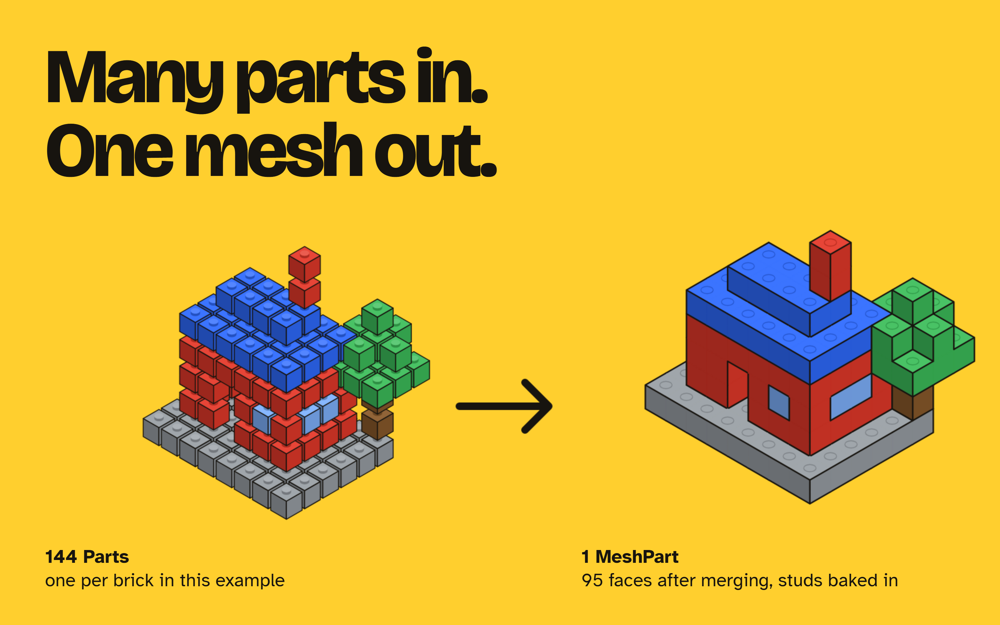
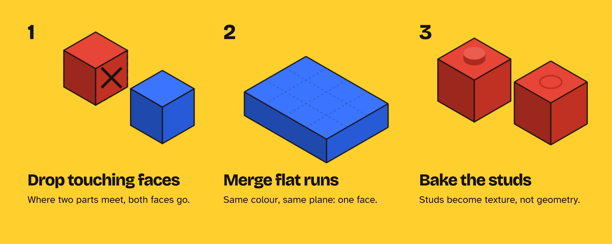
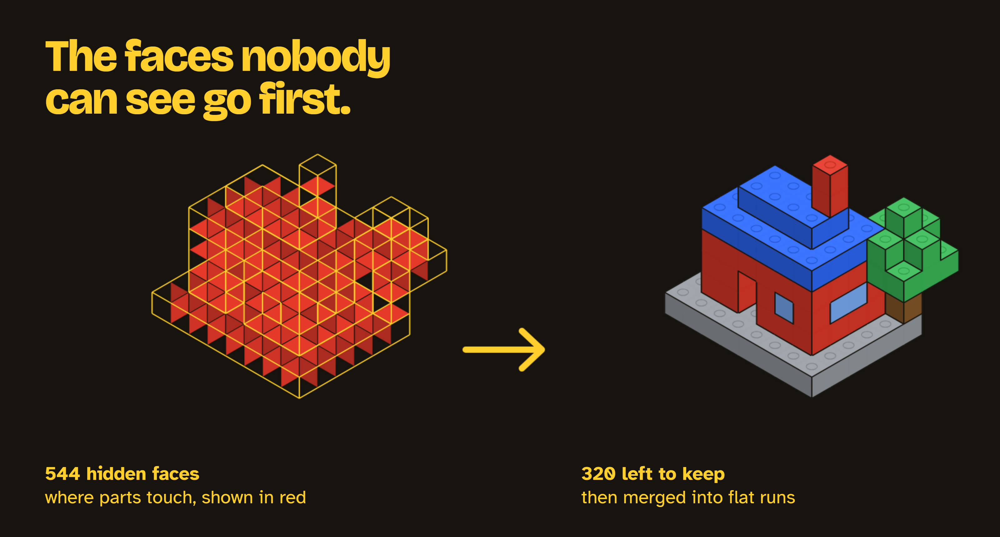

# roblox-part-to-mesh

A Roblox Studio plugin that bakes a build made of block Parts into one textured MeshPart, with the faces nobody can see removed.

<p align="center">
  
</p>

```powershell
pip install -r backend/requirements.txt
python backend/app.py
```

Paste your Open Cloud key into the window that opens, then copy `plugin/Mesh To Part.rbxmx` into Studio's plugins folder. Details are under [Install](#install).

Select a model and click **Optimize Selected Model**. The mesh is uploaded as a Roblox asset and dropped into Studio as `<name>_Optimized`, right beside your original, which stays untouched.

## What it does

<p align="center">
  
</p>

| Step | What happens to your build |
|---|---|
| Drop touching faces | Every face pressed against another part is deleted. Nobody can see it. |
| Merge flat runs | Neighbouring faces of the same colour on the same plane become one rectangle. |
| Bake the studs | Part colours and the stud pattern go into one texture atlas, so studs cost no triangles. |
| Upload | The mesh goes to Open Cloud as a `Model` asset under your user or group, then lands beside your original in Studio. |

<p align="center">
  
</p>

The numbers in these pictures come from the example house drawn in them, not from a benchmark. Your savings depend on how tightly packed your build is: solid walls and floors lose the most.

## How it works

**Studio plugin** → **backend on `127.0.0.1`** → `.glb` → **Open Cloud** → **back into Studio**

The plugin sends your Parts to the backend on your own machine. The backend builds and uploads the mesh, and your Open Cloud key never leaves it.

## Two backends

| | Desktop app | Pipeline server |
|---|---|---|
| Start | `python backend/app.py`, or the built `.exe` | `python backend/server.py` |
| Port | `8790` (the plugin's default) | `8788` (set the URL in the plugin) |
| API key | Typed into the app's setup window | `ROBLOX_OPEN_CLOUD_API_KEY` environment variable |
| Hidden faces | Removed in Python | Removed in headless Blender with HiddenGeometryRemoval |
| Needs | Python 3.10+ | Python, Blender 4.x+, `gltfpack`; `gltf-transform` optional |
| Use it when | You want it working in two minutes | You want Blender's cleanup and a packed `.glb` to inspect |

## Install

**Backend.** Install the Python packages, then start the app:

```powershell
pip install -r backend/requirements.txt
python backend/app.py
```

On first run it asks for your Open Cloud API key. Create one at [create.roblox.com/dashboard/credentials](https://create.roblox.com/dashboard/credentials) with the **Assets** API (read and write) for the user or group that should own the meshes.

To build a standalone Windows app instead: `backend/build_exe.ps1` writes `backend/dist/Mesh To Part Backend.exe`.

**Plugin.** Copy `plugin/Mesh To Part.rbxmx` into your local plugins folder (in Studio: **Plugins → Plugins Folder**), then restart Studio. Turn on **Game Settings → Security → Allow HTTP Requests**.

## Use it

Open the panel from the **Mesh Optimizer** toolbar button and fill it in once:

| Field | What to put there |
|---|---|
| Backend URL | `http://127.0.0.1:8790` (desktop app) or `:8788` (pipeline server) |
| Creator type | `user` or `group` |
| Creator ID | Your user ID or group ID: the owner of the uploaded asset |
| Stud size | Bigger studs, fewer repeats on each face |
| Stud opacity | How dark the baked studs are; above 1.00 pushes them darker |

Select one model built from block Parts and click **Optimize Selected Model**.

> [!IMPORTANT]
> Only `Part` instances with `Shape = Block` are converted. Wedges, cylinders, spheres, unions, MeshParts and CSG are not supported yet.

<details>
<summary>Pipeline server: Blender and gltfpack setup</summary>

```powershell
$env:ROBLOX_OPEN_CLOUD_API_KEY = "<your key>"
$env:ROBLOX_MESH_OPTIMIZER_BLENDER = "C:\Program Files\Blender Foundation\Blender 4.5\blender.exe"
$env:ROBLOX_MESH_OPTIMIZER_GLTFPACK = "C:\path\to\gltfpack.exe"
python backend/server.py
```

Blender is also found on `PATH` or in the default `C:\Program Files\Blender Foundation\Blender*` folder; `gltfpack` on `PATH`.

| Variable | Default | Does |
|---|---|---|
| `ROBLOX_MESH_OPTIMIZER_USE_GLTF_TRANSFORM` | off | `1` runs `gltf-transform optimize` before `gltfpack` (`npm i -g @gltf-transform/cli`) |
| `ROBLOX_MESH_OPTIMIZER_GLTF_TRANSFORM` | on `PATH` | Path to `gltf-transform` |
| `ROBLOX_MESH_OPTIMIZER_GLTFPACK_ARGS` | | Extra `gltfpack` flags, e.g. `-cc -tc` |
| `ROBLOX_MESH_OPTIMIZER_HGR_ROWS` | | HiddenGeometryRemoval camera rows |
| `ROBLOX_MESH_OPTIMIZER_HGR_CAMERAS_PER_ROW` | | Cameras per row |
| `ROBLOX_MESH_OPTIMIZER_HGR_PRECISION` | | e.g. `HIGH` |

Intermediate files land in `backend/out/jobs/<job>/`: `source.glb`, `cleaned.glb` (the one uploaded to Roblox), `transformed.glb` (with gltf-transform) and `final.glb` (the `gltfpack` output, kept for comparison; Roblox's importer drops its texture, so it is not uploaded).

Self-test, which writes `backend/out/selftest.glb`:

```powershell
python backend/server.py --self-test
```

</details>

<details>
<summary>The backend says <code>uploadConfigured: false</code></summary>

Check `Invoke-RestMethod http://127.0.0.1:8788/health` (or `:8790`). `uploadConfigured: false` means no API key reached the backend: paste it in the desktop app, or start the pipeline server from the same shell where you set `ROBLOX_OPEN_CLOUD_API_KEY`. `optimizerConfigured: false` means Blender or `gltfpack` was not found.

</details>

## Credits

- Hidden-face removal in the pipeline server uses **HiddenGeometryRemoval** by Seungwoo Lee (MIT), vendored in `backend/vendor/`.
- The stud texture is based on **dudeax/Roblox-HD-Studs**.
- Meshes are written with [trimesh](https://github.com/mikedh/trimesh) and packed with [gltfpack](https://github.com/zeux/meshoptimizer).
- The README pictures are drawn in code in [`docs/art/`](docs/art/); re-render them with `sh docs/art/render.sh`.
